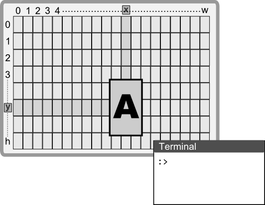

# Backends

AppCUI supports various backends (but each one comes with advantages and drawbacks).
A backend is the layer that takes the information (characters) from AppCUI's virtual screen and displays it in the terminal.



Each backend supported by AppCUI has the following properties:
* **Output rendering** - each character from the AppCUI surface is displayed on the screen
* **Input reading** - the backend is capable of identifying keyboard and mouse events and converting them to internal AppCUI events
* **Clipboard support** - the backend interacts with the OS and provides functionality for Copy / Cut / Paste using OS APIs

The following backends are supported:
1. Windows Console
2. Windows VT (Virtual Terminal)
3. NCurses
4. Termios
5. Web Terminal
6. CrossTerm

**Remarks:** These types are available via `appcui::backend::Type` and can be used to initialize an application.

```rust
App::new().backend(appcui::backend::Type::/*type*/).run()?
```

where the `appcui::backend::Type` enum is defined as follows:

```rust
pub enum Type {
    #[cfg(target_os = "windows")]
    WindowsConsole,
    #[cfg(target_os = "windows")]
    WindowsVT,
    #[cfg(target_family = "unix")]
    Termios,
    #[cfg(all(target_family = "unix", feature = "NCURSES"))]
    NcursesTerminal,
    #[cfg(target_arch = "wasm32")]
    WebTerminal,
    #[cfg(feature = "CROSSTERM")]
    CrossTerm,
}
```

## OS Support

| OS      | Windows Console | Windows VT | NCurses   | Termios | Web Terminal | CrossTerm   |
| ------- | --------------- | ---------- | --------- | ------- | ------------ | ----------- |
| Windows | Yes             | Yes        | -         | -       | -            | `CROSSTERM` |
| Linux   | -               | -          | `NCURSES` | Yes     | -            | `CROSSTERM` |
| macOS   | -               | -          | `NCURSES` | Yes     | -            | `CROSSTERM` |
| Web     | -               | -          | -         | -       | Yes          | -           |

`Yes` means the backend is compiled in. A feature name means that backend is compiled only when that crate feature is enabled. Termios is built in on Linux and macOS. NCurses and CrossTerm are never selected automatically.


## Display

Each backend comes with different support related to what can be displayed on the screen.
* **16 colors** - support for 16 colors for foreground and background 
* **True colors** - support for true colors (24-bit) for foreground and background
* **UTF-8** - support for UTF-8 encoding
* **Ascii** - support for ASCII encoding
* **WTF-16** - support for WTF-16 encoding (a subset of UTF-8) - only for Windows
* **Cursor** - support for cursor
* **Cursor Blinking** - support for cursor blinking

| Display         | Windows Console | Windows VT | NCurses | Termios | Web Terminal | CrossTerm |
| --------------- | --------------- | ---------- | ------- | ------- | ------------ | --------- |
| 16 colors       | Yes             | Yes        | Yes     | Yes     | Yes          | Yes       |
| True colors     | -               | Yes        | -       | Yes     | Yes          | Yes       |
| ASCII           | Yes             | Yes        | Yes     | Yes     | Yes          | Yes       |
| WTF-16          | Yes             | Yes        | Yes     | Yes     | Yes          | Yes       |
| UTF-8           | -               | Yes        | -       | Yes     | Yes          | Yes       |
| Cursor          | Yes             | Yes        | Yes     | Yes     | Yes          | Yes       |
| Cursor Blinking | Yes             | Yes        | -       | -       | -            | Yes       |

**Remarks**:
1. **True colors** support requires the feature `TRUE_COLORS` to be enabled (keep in mind that by doing this you also increase the size of your Color and Character structures - if you don't need this or your terminal does not support true colors, you will only allocate additional space that will not be used).
2. **Cursor blinking** is not supported by all terminals (AppCUI can show or hide the cursor, but it is the terminal's job to make it blink).

In terms of the output method, each backend uses a different approach:

| Backend         | Output method                                                                                  |
| --------------- | ---------------------------------------------------------------------------------------------- |
| Windows Console | Direct output via Windows API                                                                  |
| Windows VT      | ANSI sequences                                                                                 |
| NCurses         | Direct output via NCurses API. Enable the `NCURSES` feature and install ncurses on the system. |
| Termios         | ANSI sequences                                                                                 |
| Web Terminal    | HTML elements and browser APIs                                                                 |
| CrossTerm       | ANSI sequences (directly via the `crossterm` crate API)                                        |

## Character Attributes

Besides background and foreground colors, the following character attributes are supported:

| Display          | Windows Console | Windows VT | NCurses | Termios | Web Terminal | CrossTerm |
| ---------------- | --------------- | ---------- | ------- | ------- | ------------ | --------- |
| Bold             | -               | Yes        | Yes     | Yes     | -            | Yes       |
| Underline        | Yes             | Yes        | Yes     | Yes     | Yes          | Yes       |
| Italic           | -               | Yes        | -       | Yes     | -            | Yes       |
| Curly Underline  | -               | Yes        | -       | Yes     | -            | Yes       |
| Double Underline | -               | Yes        | -       | Yes     | -            | Yes       |
| Dotted Underline | -               | Yes        | -       | Yes     | -            | Yes       |
| Strike Through   | -               | Yes        | -       | Yes     | -            | Yes       |


## Input

Capturing the input implies the following capabilities from any backend:
* identifying keyboard events
* identifying keyboard combinations such as `Alt`+Key or `Ctrl`+Key or `Alt+Ctrl`+Key
* Identifying that the state of the `Shift`, `Ctrl` and `Alt` keys has changed (pressed or released)
* Identifying mouse events
* Identifying mouse combinations such as `Alt`+Mouse or `Ctrl`+Mouse or `Alt+Ctrl`+Mouse
* Identifying mouse drag / move events
* Identifying mouse wheel events

### Keyboard

| Keys               | Windows Console | Windows VT | NCurses | Termios | Web Terminal | CrossTerm |
| ------------------ | --------------- | ---------- | ------- | ------- | ------------ | --------- |
| Alt+Key            | Yes             | Yes        | Yes     | Yes     | Yes          | Yes       |
| Shift+Key          | Yes             | Yes        | Yes     | Yes     | Yes          | Yes       |
| Ctrl+Key           | Yes             | Yes        | Yes     | Yes     | Yes          | Yes       |
| Alt+Shift+Key      | Yes             | Yes        | -       | Yes     | -            | -         |
| Ctrl+Shift+Key     | Yes             | Yes        | -       | -       | -            | -         |
| Ctrl+Alt+Key       | Yes             | Yes        | -       | Yes     | -            | -         |
| Ctrl+Alt+Shift+Key | Yes             | Yes        | -       | -       | -            | -         |
| Alt pressed        | Yes             | Yes        | -       | -       | -            | -         |
| Shift pressed      | Yes             | Yes        | -       | -       | -            | -         |
| Ctrl pressed       | Yes             | Yes        | -       | -       | -            | -         |

### Mouse

| Mouse events | Windows Console | Windows VT | NCurses | Termios | Web Terminal | CrossTerm |
| ------------ | --------------- | ---------- | ------- | ------- | ------------ | --------- |
| Click        | Yes             | Yes        | Yes     | Yes     | Yes          | Yes       |
| Move & Drag  | Yes             | Yes        | Yes     | Yes     | Yes          | Yes       |
| Wheel        | Yes             | Yes        | Yes     | -       | Yes          | Yes       |

**Remarks:** Input support is highly dependent on the terminal and the OS. Termios maps `Alt+Shift` and `Ctrl+Alt` for letters (an ESC prefix) and for CSI keys such as arrows, function keys, Home, End, Page Up, Page Down, Insert, Delete, and Tab. `Ctrl+Shift` and `Ctrl+Alt+Shift` on a letter stay in the `Ctrl` and `Ctrl+Alt` bytes, so those two rows stay unsupported. See [Termios](backends/termios.md#todo). AppCUI uses the following approach to intercept input:

| Backend         | Approach                                                                                                                  |
| --------------- | ------------------------------------------------------------------------------------------------------------------------- |
| Windows Console | Read the input directly from the console via Windows API                                                                  |
| Windows VT      | Read the input directly from the console via Windows API                                                                  |
| NCurses         | Read the input directly from the console via NCurses API. Enable the `NCURSES` feature and install ncurses on the system. |
| Termios         | Read the input directly from the console via Termios API                                                                  |
| Web Terminal    | Read the input directly from the browser                                                                                  |
| CrossTerm       | Read the input via the `crossterm` crate API                                                                              |


## System events

System events are events that are not related to the keyboard or mouse, but are related to the system and indicate that the console has been changed in some way.

| Events         | Windows Console | Windows VT | NCurses | Termios | Web Terminal | CrossTerm |
| -------------- | --------------- | ---------- | ------- | ------- | ------------ | --------- |
| Console Resize | Yes             | Yes        | Yes     | Yes     | Yes          | Yes       |
| Console Closed | Yes             | Yes        | -       | -       | Yes          | -         |

## Other capabilities

| Capabilities    | Windows Console | Windows VT | NCurses | Termios | Web Terminal | CrossTerm |
| --------------- | --------------- | ---------- | ------- | ------- | ------------ | --------- |
| Set dimension   | Yes             | Yes        | -       | -       | Yes          | -         |
| Set title       | Yes             | Yes        | -       | -       | Yes          | -         |
| Restore screen  | Yes             | Yes        | -       | -       | `N/A`        | -         |
| Set palette     | Yes             | Yes        | -       | Yes     | -            | Yes       |
| Restore palette | Yes             | Yes        | -       | Yes     | -            | Yes       |
| ANSI Based      | -               | Yes        | -       | Yes     | -            | Yes       |

* `N/A` (not applicable) means that there is no original screen prior to the app execution so there is nothing to restore.
* **Restore palette** is `Yes` for Termios and CrossTerm because those backends send OSC 104 on exit. The terminal decides whether those colors actually return. Some terminals, such as WSL, keep the palette that was set. See [Termios](backends/termios.md#limitations) and [CrossTerm](backends/crossterm.md#palette).

## Panic

If the application panics, AppCUI restores the terminal before Rust prints the panic message. Raw mode is turned off, mouse capture stops, and the cursor is shown. A palette the backend changed is reset the same way as on a normal exit.

Windows Console, Windows VT, Termios, and NCurses keep the last frame on screen and start the panic message on the line under that frame. Windows Console and Windows VT place the cursor on that next line. Termios and NCurses place it at column 0 of the last visible row and print a newline, which scrolls the message under the desktop.

| Backend         | What a panic does                                                                                                                                                                                                                                                             |
| --------------- | ----------------------------------------------------------------------------------------------------------------------------------------------------------------------------------------------------------------------------------------------------------------------------- |
| Windows Console | Keeps the last frame. Moves the cursor to the line under the AppCUI surface and shows the cursor. Restores the console mode and, when it was changed, the 16-color table.                                                                                                     |
| Windows VT      | Keeps the last frame and places the cursor the same way as Windows Console. Turns mouse tracking off. Sends OSC 104 when the 16 color slots were changed.                                                                                                                     |
| Termios         | Keeps the last frame. Moves the cursor to column 0 of the last visible row, then prints a newline so the panic message starts under the desktop. Restores the termios modes from before the application, turns mouse tracking off, and shows the cursor. Sends OSC 104 when the 16 color slots were changed. |
| NCurses         | Keeps the last frame. Reads the screen height, leaves ncurses with `endwin`, moves the cursor to column 0 of the last visible row, and prints a newline so the panic message starts under the desktop. `endwin` restores the tty modes from startup. Turns mouse tracking off and shows the cursor. |
| CrossTerm       | Leaves the alternate screen, which brings back the terminal contents from before the application. Turns raw mode and mouse capture off, shows the cursor, and resets colors. Prints a blank line, then the panic message. Sends OSC 104 when the 16 color slots were changed. |
| Web Terminal    | Leaves the canvas as it is. The panic message is written to the browser console.                                                                                                                                                                                              |

A normal exit runs the same mode, mouse, cursor, and palette cleanup. Windows Console and Windows VT then put back the screen from before the application. Termios and NCurses clear the screen. CrossTerm leaves the alternate screen.

The `panic` example (`examples/panic`) opens a window with a button that panics.

## Clipboard

AppCUI provides clipboard support for copying and pasting text. The clipboard functionality is available on the following backends:

| Backend         | Clipboard Support | API Used                                                   |
| --------------- | ----------------- | ---------------------------------------------------------- |
| Windows Console | Yes               | Windows API                                                |
| Windows VT      | Yes               | Windows API                                                |
| NCurses         | Yes               | via copypasta crate                                        |
| Termios         | Yes               | via copypasta crate                                        |
| Web Terminal    | Yes               | Browser API                                                |
| CrossTerm       | Yes               | via copypasta crate (Linux/macOS) or Windows API (Windows) |

## Defaults

By default, when initializing an `App` object via `App::new()`, the following backend will be used:

| OS      | Default backend | Other available backends                     |
| ------- | --------------- | -------------------------------------------- |
| Windows | Windows Console | Windows VT, CrossTerm (`CROSSTERM`)          |
| Linux   | Termios         | NCurses (`NCURSES`), CrossTerm (`CROSSTERM`) |
| macOS   | Termios         | NCurses (`NCURSES`), CrossTerm (`CROSSTERM`) |
| Web     | Web Terminal    | —                                            |

`App::new()` uses the default backend for the current OS. NCurses and CrossTerm are used only when the matching feature is enabled and `.backend(...)` selects them.
