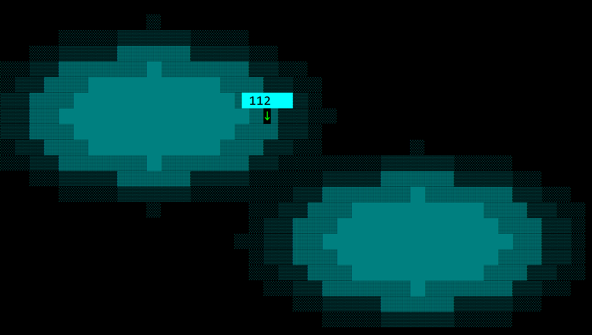

# HeatMap

A `HeatMap` draws a grid of cells. Each cell stores a number. The value type `T` is any numeric type that implements `Number`: `i8`, `i16`, `i32`, `i64`, `i128`, `u8`, `u16`, `u32`, `u64`, `u128`, `usize`, `isize`, `f32`, or `f64`. A cell's character and, with a color range, its color follow that cell's place between the smallest and the largest value in the grid. An empty position stays blank. Row `0` is the top row and column `0` is the left column.



Create one with `HeatMap::new` (a layout, a grid size, and initialization flags) or with the `heatmap!` macro. The grid size is columns by rows: `Size::new(4, 3)` is 4 columns and 3 rows. With `HeatMap::new`, name the numeric type on the variable or with a turbofish:

```rs
let map: HeatMap<i32> = HeatMap::new(layout!("d:f"), Size::new(4, 3), heatmap::Flags::None);
let map = HeatMap::<f64>::new(layout!("d:f"), Size::new(10, 10), heatmap::Flags::ScrollBars);
```

The macro takes the numeric type as its first parameter and the grid size as its second. `columns` and `rows` are the same size written as two numbers. Use one of those forms, not both. Each side is a whole number from 1 to 32000.

```rs
let m1 = heatmap!("i32, 4x3, d:f");
let m2 = heatmap!("type: i32, size: 24x14, flags: ScrollBars+Margins, values: [[1, 2], [3, 4]]");
let m3 = heatmap!("f64, columns: 2, rows: 2, x:1, y:1, w:30, h:10, fill: Dots, attr: Range(blue, red)");
```

A new heat map starts empty. A cell is 2 characters wide and 1 tall. The hover tooltip shows the label and the value. Cells are drawn with shades (a space, `░`, `▒`, `▓`, or `█`) in the theme's first chart color.

A HeatMap supports all common parameters (as they are described in [Instantiate via Macros](../instantiate_via_macros.md) section). Besides them, the following **named parameters** are also accepted:

| Parameter name                             | Type    | Positional parameter | Purpose                                                                               |
| ------------------------------------------ | ------- | -------------------- | ------------------------------------------------------------------------------------- |
| `class` or `type`                          | String  | **Yes** (first)      | Numeric type of the cell values (`i32`, `f64`, ...)                                   |
| `size` or `grid` or `sz` or `heatmap-size` | Size    | **Yes** (second)     | Columns and rows, written as `24x14` or `24,14`. The first number is the column count |
| `columns` or `cols`                        | Integer | **No**               | Number of columns. Use this together with `rows`, instead of `size`                   |
| `rows`                                     | Integer | **No**               | Number of rows. Use this together with `columns`, instead of `size`                   |
| `values` or `data` or `cells`              | List    | **No**               | Initial cells. A grid of rows, or a flat list in row order                            |
| `flags`                                    | Flags   | **No**               | Initialization flags                                                                  |
| `cell-size` or `cellsize` or `cs`          | Size    | **No**               | Width and height of one cell, in characters. The default is `2x1`                     |
| `tooltip` or `tooltip-format` or `tf`      | String  | **No**               | What the hover tooltip shows                                                          |
| `fill` or `default-fill`                   | String  | **No**               | Characters used by cells that do not set their own fill                               |
| `attr` or `default-attr` or `color`        | Dict    | **No**               | Colors used by cells that do not set their own attribute                              |
| `selected`                                 | Dict    | **No**               | The cell that is selected when the heat map starts, as `{row, column}`                |

## Flags

* `heatmap::Flags::ScrollBars` or `ScrollBars` (for macro initialization) — shows horizontal and vertical scroll bars when the heat map is larger than the control. The right and bottom margins grow while the heat map has focus so the bars stay visible.
* `heatmap::Flags::Margins` or `Margins` — leaves one empty character around the grid. That border is part of the image: it is there at the start and at the end of the scroll, and it moves with the cells. It uses the chart background. A selected cell is outlined with a rectangle drawn in that free space.
* `heatmap::Flags::DimCellsOnSelection` or `DimCellsOnSelection` — while a cell is selected, every other cell is drawn with the inactive chart color. The selected cell keeps its own color.

```rs
let map = heatmap!("i32, 8x6, d:f, flags: ScrollBars+Margins+DimCellsOnSelection");
```

## Cells

A cell has a value, a label (that can be empty), a fill, and a character attribute. A fill or an attribute that is left unset uses the heat map default. A number passed to `set`, `set_values`, or `fill_with`, or written in the macro list, is a cell with that value, an empty label, and the heat map's default fill and attribute.

```rs
map.set(0, 1, 10);
map.set(1, 2, heatmap::CellBuilder::new(20).label("Peak").fill(heatmap::CellFill::Stars).build());
map.set_values([1, 5, 9, 2]);
```

In the `values` (or `data`, or `cells`) list, the cells can be written in either of two forms:

* A grid of rows. Each inner list is one row, from top to bottom, and each item in that list is one cell, from left to right: `[[1, 2], [3, 4]]`.
* A flat list in row order. The first row is filled from left to right, then the next row: `[1, 2, 3, 4]`.

A cell is a number, an empty cell (`none` or `_`), or a dictionary. `value` is required in a dictionary. The other fields are optional. A list that is shorter than the grid leaves the remaining positions empty.

| Parameter name                                 | Type   | Positional parameter | Purpose                                          |
| ---------------------------------------------- | ------ | -------------------- | ------------------------------------------------ |
| `value` or `val` or `v`                        | Number | **Yes** (first)      | The cell value                                   |
| `label` or `text` or `caption` or `name`       | String | **Yes** (second)     | The cell label                                   |
| `fill` or `fill-type` or `filltype` or `ft`    | String | **No**               | The characters that draw this cell               |
| `attr` or `attribute` or `charattr` or `color` | Dict   | **No**               | Character attribute (same syntax as `charattr!`) |

```rs
let map = heatmap!(
    "i32, 3x2, d:f, values: [
        [1, {10, 'Peak', fill: Stars, attr: green}, 3],
        [none, 4, _]
    ]"
);
```

`clear_cell` empties one position. `clear_all` empties every position and clears the selection. The grid size, the flags, the cell size, the tooltip, and the default fill and attribute stay as they are.

## Fill

`fill` (or `set_default_fill`) chooses the characters used by cells that do not set their own. The values are available from code as `heatmap::CellFill`. Each fill except `Custom` picks one character from its list. A space is used at 0% and the last character at 100%. The percentage is that cell's place between the smallest and the largest value. `Shades` is the default. `Custom` repeats one character and ignores the percentage.

| Fill        | Macro form                                      | Characters, from 0% to 100%             |
| ----------- | ----------------------------------------------- | --------------------------------------- |
| `Shades`    | `Shades`                                        | ` ` `░` `▒` `▓` `█`                     |
| `Dots`      | `Dots`                                          | ` ` `·` `•` `●`                         |
| `ASCII`     | `ASCII`                                         | ` ` `.` `:` `-` `=` `+` `x` `#` `%` `@` |
| `Circles`   | `Circles`                                       | ` ` `·` `∘` `○` `◎` `●`                 |
| `Squares`   | `Squares`                                       | ` ` `▫` `□` `▪` `■`                     |
| `Diamonds`  | `Diamonds`                                      | ` ` `◇` `◈` `◆`                         |
| `Crosses`   | `Crosses`                                       | ` ` `·` `+` `✚`                         |
| `Stars`     | `Stars`                                         | ` ` `✧` `✦` `✶` `✹`                     |
| `Asterisks` | `Asterisks`                                     | ` ` `✢` `✣` `✤` `✥`                     |
| `Flowers`   | `Flowers`                                       | ` ` `❀` `❁` `✿`                         |
| `Pluses`    | `Pluses`                                        | ` ` `✛` `✜` `✚`                         |
| `Custom`    | `Custom('#')`, `Custom(code: 0x2588)`, or `'#'` | that character                          |

```rs
map.set_default_fill(heatmap::CellFill::Dots);
map.clear_default_fill();
```

`clear_default_fill` returns cells that do not have their own fill to shades. A cell that set its own fill keeps it.

## Colors

`attr` (or `set_default_attr`) chooses the colors used by cells that do not set their own. The values are available from code as `heatmap::CellAttribute`. Without a default attribute, those cells use the theme's first chart color.

| Value               | Macro form                                          | Description                                                                                |
| ------------------- | --------------------------------------------------- | ------------------------------------------------------------------------------------------ |
| `Fixed(attr)`       | `Fixed(red)` or `red` or `{fore: red, back: black}` | One character attribute for every value. The attribute uses the same syntax as `charattr!` |
| `Range(start, end)` | `Range(blue, red)`                                  | Blends from `start` at the smallest value to `end` at the largest                          |

```rs
let map = heatmap!("i32, 4x3, d:f, attr: Range(blue, red), values: [1, 5, 9, 2]");
map.set_default_attr(heatmap::CellAttribute::Fixed(CharAttribute::with_color(Color::Red, Color::Black)));
map.clear_default_attr();
```

`clear_default_attr` returns cells that do not have their own attribute to the theme color. A cell that set its own attribute keeps it.

## Tooltip

`tooltip` (or `set_tooltip_format`) chooses what the hover tooltip shows. The values are available from code as `heatmap::TooltipFormat`. Read the current choice with `tooltip_format`.

| Value                | Macro form                                                           | Shows                                                               |
| -------------------- | -------------------------------------------------------------------- | ------------------------------------------------------------------- |
| `LabelAndValue`      | `LabelAndValue` or `label-and-value` or `label+value`                | `label: value`. This is the default                                 |
| `Value`              | `Value`                                                              | The value of the cell                                               |
| `Label`              | `Label`                                                              | The label of the cell                                               |
| `Percentage`         | `Percentage` or `percent`                                            | The cell's place between the smallest and the largest value (`42%`) |
| `LabelAndPercentage` | `LabelAndPercentage` or `label-and-percentage` or `label+percentage` | `label: percentage`                                                 |

With `LabelAndValue` and `LabelAndPercentage`, a cell with an empty label shows only its value or percentage. With `Label`, a cell with an empty label shows no tooltip. An empty position shows no tooltip either. A value is written with the text of its number. A percentage is a whole number from `0%` to `100%`. When every value is equal, the percentage is `100%`.

```rs
let map = heatmap!("i32, 4x3, d:f, tooltip: LabelAndPercentage");
map.set_tooltip_format(heatmap::TooltipFormat::Value);
```

## Selection

A cell is selected by clicking it, with the keyboard, or with `set_selected_cell`. The selected cell is outlined. With `Margins` the outline is a rectangle drawn in the free character around the cell. Without margins, a cell that is one row tall is marked with brackets, a cell that is two rows tall is marked with corners, and a taller cell is marked with a rectangle. With `DimCellsOnSelection`, the other cells are dimmed. The outline stays when the heat map loses the focus. A disabled heat map is drawn with the inactive color and shows no selection.

The keyboard skips empty positions. A click on an empty position, or on the margin, clears the selection. `Escape` clears it as well. `clear_cell` clears the selection when that cell was selected, and `clear_all` always clears it. Losing the focus does not.

In the macro, `selected: {row, column}` selects that cell at the start. The named keys are `row` or `r`, and `column`, `col`, or `c`.

`set_selected_cell` can select an empty position. A position outside the grid is ignored. Changing the selection from code does not raise an event.

## Events

To intercept events from a HeatMap, implement `HeatMapEvents<T>` on the window that runs the event loop. The attribute `events = HeatMapEvents<T>` generates the trait. Both methods are required.

```rs
pub trait HeatMapEvents<T> {
    fn on_cell_selected(&mut self, handle: Handle<HeatMap<T>>, row: u32, column: u32) -> EventProcessStatus;
    fn on_clear_selection(&mut self, handle: Handle<HeatMap<T>>) -> EventProcessStatus;
}
```

`on_cell_selected` runs when the user selects a cell (by clicking it, or with the arrow keys). `row` and `column` are the position of that cell. `on_clear_selection` runs when the user clears the selection (by clicking an empty position or the margin, or with `Escape`). Selecting the cell that is already selected does not raise the event again.

The events are raised only for user actions. Changing the selection from code with `set_selected_cell`, emptying cells with `clear_cell` or `clear_all`, or dropping a selected cell by shrinking the grid with `set_heatmap_size`, does not raise them.

## Methods

Besides the [Common methods for all Controls](../common_methods.md), a HeatMap also has the following additional methods:

| Method                        | Purpose                                                                                                                                                |
| ----------------------------- | ------------------------------------------------------------------------------------------------------------------------------------------------------ |
| `cell_size()`                 | The width and height, in characters, of one cell. The default is 2 by 1                                                                                |
| `set_cell_size(...)`          | Sets that size and repaints. A width or height of 0 is ignored                                                                                         |
| `heatmap_size()`              | The number of columns (`width`) and rows (`height`)                                                                                                    |
| `set_heatmap_size(...)`       | Sets the number of columns and rows and repaints. Cells that still fit stay. New positions are empty. A width or height of 0 is ignored                |
| `set(row, column, cell)`      | Sets the cell at that position. A number is a cell with an empty label and the heat map defaults. A position outside the grid is ignored               |
| `cell(row, column)`           | Returns `Some(&Cell<T>)`, or `None` when the position is empty or outside the grid                                                                     |
| `update_cell(row, column, f)` | Changes the cell at that position. An empty position, or one outside the grid, is ignored                                                              |
| `clear_cell(row, column)`     | Empties that position. Clears the selection when that cell was selected. Does not raise an event                                                       |
| `clear_all()`                 | Empties every cell and clears the selection. Does not raise an event                                                                                   |
| `set_values(...)`             | Sets cells in row order, starting at `(0, 0)`, and returns how many were written. Extra values are ignored. Cells past the last value stay as they are |
| `fill_with(f)`                | Sets every cell from `f(row, column)`. Returning `None` leaves that position empty                                                                     |
| `update_with(f)`              | Calls `f(row, column, cell)` for every position, so cells can be changed, added, or removed in one pass                                                |
| `set_default_fill(...)`       | Sets the `CellFill` used by cells that do not have their own, and repaints                                                                             |
| `default_fill()`              | Returns that fill, or `None` when cells use shades                                                                                                     |
| `clear_default_fill()`        | Removes the default fill and repaints. Cells without their own fill are drawn with shades                                                              |
| `set_default_attr(...)`       | Sets the `CellAttribute` used by cells that do not have their own, and repaints                                                                        |
| `default_attr()`              | Returns that attribute, or `None` when cells use the theme's first chart color                                                                         |
| `clear_default_attr()`        | Removes the default attribute and repaints. Cells without their own attribute use the theme color                                                      |
| `set_tooltip_format(...)`     | Sets the `TooltipFormat` of the hover tooltip                                                                                                          |
| `tooltip_format()`            | Returns the `TooltipFormat` of the hover tooltip                                                                                                       |
| `selected_cell()`             | Returns the selected cell as `(row, column)`, or `None`                                                                                                |
| `set_selected_cell(...)`      | Selects `(row, column)`, or clears the selection when the argument is `None`. Does not raise an event                                                  |

### `Cell`

On a cell returned by `cell`, or passed into `update_cell`:

| Method                                      | Purpose                                                     |
| ------------------------------------------- | ----------------------------------------------------------- |
| `value()`                                   | The number stored in this cell                              |
| `label()` / `set_label(...)`                | The label shown by tooltip formats that include a label     |
| `fill()` / `set_fill(...)` / `clear_fill()` | This cell's fill, or the heat map default when cleared      |
| `attr()` / `set_attr(...)` / `clear_attr()` | This cell's attribute, or the heat map default when cleared |

`CellBuilder` sets only the properties that should differ from the heat map defaults. `label`, `fill`, and `attr` return the builder, so they can be chained. `build` returns the cell. A builder can also be passed straight to `set`.

```rs
map.update_cell(1, 2, |cell| {
    cell.set_label("Peak");
    cell.set_fill(heatmap::CellFill::Stars);
});
```

## Key association

The following keys are processed by a HeatMap when it has focus. Empty positions are skipped, and the selection wraps around. When the grid has no filled cells, an arrow key clears the selection. `Left` and `Right` walk the grid in row order. `Up` and `Down` walk it in column order. Moving the selection scrolls so that cell stays in view.

| Key                        | Purpose                                                                             |
| -------------------------- | ----------------------------------------------------------------------------------- |
| `Right`                    | Selects the next filled cell in row order (the first one if none is selected)       |
| `Left`                     | Selects the previous filled cell in row order (the last one if none is selected)    |
| `Down`                     | Selects the next filled cell in column order (the first one if none is selected)    |
| `Up`                       | Selects the previous filled cell in column order (the last one if none is selected) |
| `Escape`                   | Clears the selection                                                                |
| `Ctrl+Left` / `Ctrl+Right` | Scrolls one cell left or right. The selection stays where it is                     |
| `Ctrl+Up` / `Ctrl+Down`    | Scrolls one cell up or down. The selection stays where it is                        |
| `Ctrl+Home`                | Scrolls to the start of the heat map                                                |
| `Ctrl+End`                 | Scrolls to the end of the heat map                                                  |

## Mouse association

| Action                                      | Purpose                                                                               |
| ------------------------------------------- | ------------------------------------------------------------------------------------- |
| Hover                                       | Shows the tooltip of the cell under the cursor. The text is chosen by `TooltipFormat` |
| Click on a cell                             | Selects that cell and raises `on_cell_selected` when the selection changes            |
| Click on an empty position or on the margin | Clears the selection and raises `on_clear_selection` when a cell was selected         |
| Wheel                                       | Scrolls one cell in that direction                                                    |
| Drag a scroll bar                           | Scrolls the heat map when `ScrollBars` is enabled                                     |

## Example

The following window shows a small grid. The hottest cell has its own label and fill. Hovering a cell shows its label and its place between the coldest and the hottest value. Selecting a cell writes its row and column into the window title.

A small demo is in `examples/heatmap`. A larger editor (flags, cell size, tooltip, fill, colors, and the cells themselves) is in `examples/heatmap_editor`.

```rs
use appcui::prelude::*;

#[Window(events = HeatMapEvents<i32>)]
struct MyWin {
    map: Handle<HeatMap<i32>>,
}

impl MyWin {
    fn new() -> Self {
        let mut win = MyWin {
            base: window!("'Heat map',a:c,w:40,h:12,flags:Sizeable"),
            map: Handle::None,
        };
        win.map = win.add(heatmap!(
            "i32, 4x3, d:f,
             flags: Margins+DimCellsOnSelection,
             tooltip: LabelAndPercentage,
             attr: Range(blue, red),
             values: [
                [1, {8, 'Warm'}, 3, 2],
                [4, 12, {20, 'Peak', fill: Stars}, 6],
                [none, 5, 9, _]
             ]"
        ));
        win
    }
}

impl HeatMapEvents<i32> for MyWin {
    fn on_cell_selected(&mut self, _: Handle<HeatMap<i32>>, row: u32, column: u32) -> EventProcessStatus {
        self.set_title(&format!("Heat map - {row},{column}"));
        EventProcessStatus::Processed
    }

    fn on_clear_selection(&mut self, _: Handle<HeatMap<i32>>) -> EventProcessStatus {
        self.set_title("Heat map");
        EventProcessStatus::Processed
    }
}

fn main() -> Result<(), appcui::system::Error> {
    App::new().window(MyWin::new).run()
}
```
