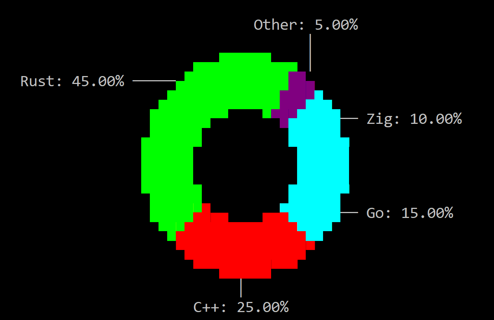

# PieChart

A `PieChart` shows a single series of values as parts of a whole. Each value is a slice whose size is proportional to its share of the total. Values are `u64`, so a slice can not be negative. A slice with the value `0` stays in the chart (and keeps its index) but takes no space.

The chart can be drawn as a circle, an ellipse, a square, a rectangle or a triangle (with or without rounded corners), with a hole in the middle (a donut), and with labels inside the slices or around the chart. The first slice can start at any angle, and the slices can follow each other clockwise or counter-clockwise.



Create one with `PieChart::new` (a layout and initialization flags) or with the `piechart!` macro:

```rs
let chart = PieChart::new(layout!("d:f"), piechart::Flags::None);
```

```rs
let c1 = piechart!("d:f");
let c2 = piechart!("x:1,y:1,w:40,h:15,values:[10,20,30]");
let c3 = piechart!("d:f,shape:Ellipse,hollow:50%,labels:Outside,content:LabelAndPercentage,values:[{50,'Rust'},{30,'C++'},{20,'Go'}]");
```

A new chart starts empty. It is drawn as a circle with half blocks, without a hole and without labels. The first slice starts at 12 o'clock and the slices follow each other clockwise. Each slice uses a theme chart color unless it has its own attribute. Values are written with thousands separators (`1,234,567`).

A PieChart supports all common parameters (as they are described in [Instantiate via Macros](../instantiate_via_macros.md) section). Besides them, the following **named parameters** are also accepted:

| Parameter name                                | Type    | Positional parameter | Purpose                                                       |
| --------------------------------------------- | ------- | -------------------- | ------------------------------------------------------------- |
| `flags`                                       | Flags   | **No**               | Initialization flags                                          |
| `values` or `data` or `slices`                | List    | **No**               | Slices to add. Each item is a number or a slice description   |
| `shape`                                       | String  | **No**               | The outline the chart is drawn in                             |
| `renderer` or `render` or `draw-mode` or `dm` | String  | **No**               | How the slices are turned into characters                     |
| `hollow` or `hole` or `hollow-thickness`      | String  | **No**               | The size of the hole in the middle of the chart               |
| `labels` or `label-layout` or `ll`            | String  | **No**               | Where the labels are drawn                                    |
| `content` or `label-content` or `lc`          | String  | **No**               | What each label shows                                         |
| `numeric-format` or `nf`                      | Dict    | **No**               | Format used for the values in labels and tooltips             |
| `angle` or `start-angle`                      | Integer | **No**               | Where the first slice starts, in degrees (0 to 360)           |
| `direction` or `dir`                          | String  | **No**               | The direction in which the slices follow each other           |
| `selected` or `select` or `selected-slice`    | Integer | **No**               | The index of the slice that is selected when the chart starts |

## Flags

* `piechart::Flags::DimSlicesOnSelection` or `DimSlicesOnSelection` (for macro initialization) — while a slice is selected, every other slice is drawn with the inactive chart color.

```rs
let chart = piechart!("d:f,flags:DimSlicesOnSelection,values:[10,20,30]");
```

## Slices

A slice has a value, a label (that can be empty) and an optional character attribute. Only the foreground color of the attribute is used. Without an attribute, slice `i` uses the theme chart color `i % 4`.

```rs
chart.add_value(50, "Rust", None);
chart.add_value(30, "C++", Some(CharAttribute::with_fore_color(Color::Red)));
chart.add_value(20, "", None);
```

The percentage of every slice is computed with two decimals, and the percentages of all slices always add up to exactly `100.00%`.

In the `values` (or `data`, or `slices`) list, an item is either a number (a slice with no label and an automatic color) or a dictionary. `value` is required. The other fields are optional.

| Parameter name                                 | Type    | Positional parameter | Purpose                                          |
| ---------------------------------------------- | ------- | -------------------- | ------------------------------------------------ |
| `value` or `val` or `v`                        | Integer | **Yes** (first)      | The slice value (a positive integer)             |
| `label` or `text` or `caption`                 | String  | **Yes** (second)     | The slice label                                  |
| `attr` or `attribute` or `charattr` or `color` | Dict    | **No**               | Character attribute (same syntax as `charattr!`) |

```rs
let chart = piechart!("d:f,values:[10,{20,'Rust'},{30,label:'C++',attr:red},{40,Go,color:{fore:green}}]");
```

## Shape

`shape` (or `set_shape`) chooses the outline the chart is drawn in. The values are available from code as `piechart::DrawModeShape`. Every shape is fitted in the control, one character away from every edge.

| Shape            | Macro form                                                           | Description                                                                                           |
| ---------------- | -------------------------------------------------------------------- | ----------------------------------------------------------------------------------------------------- |
| `Circle`         | `Circle`                                                             | The largest circle that fits, centered. This is the default                                           |
| `Ellipse`        | `Ellipse`                                                            | An ellipse that fills the control                                                                     |
| `Square`         | `Square`                                                             | The largest square that fits, centered                                                                |
| `RoundSquare`    | `RoundSquare` or `round-square`                                      | Like `Square`, with rounded corners                                                                   |
| `Rectangle`      | `Rectangle` or `rect`                                                | A rectangle that fills the control                                                                    |
| `RoundRectangle` | `RoundRectangle` or `round-rectangle` or `roundrect` or `round-rect` | Like `Rectangle`, with rounded corners                                                                |
| `Triangle`       | `Triangle`                                                           | The largest triangle with three equal sides that fits, pointing up. The slices go around its centroid |
| `RoundTriangle`  | `RoundTriangle` or `round-triangle`                                  | Like `Triangle`, with rounded corners                                                                 |

Circles and squares look round and square on screen: the chart takes into account that a character is about twice as tall as it is wide. In every shape, the area of a slice is proportional to its value.

## Renderer

`renderer` (or `set_renderer`) chooses how the slices are turned into characters. The values are available from code as `piechart::DrawModeRenderer`.

| Renderer       | Macro form                                      | Description                                                                                                     |
| -------------- | ----------------------------------------------- | --------------------------------------------------------------------------------------------------------------- |
| `HalfBlocks`   | `HalfBlocks` or `half-blocks`                   | Two pixels per character (`▀`), each with its own color. This is the default                                    |
| `Braille`      | `Braille`                                       | Braille dots, 2 x 4 pixels per character. A character takes the color of the slice that covers most of its dots |
| `Solid`        | `Solid`                                         | `█`                                                                                                             |
| `Shade75`      | `Shade75`                                       | `▓`                                                                                                             |
| `Shade50`      | `Shade50`                                       | `▒`                                                                                                             |
| `Shade25`      | `Shade25`                                       | `░`                                                                                                             |
| `Grid`         | `Grid`                                          | `┼`                                                                                                             |
| `GridDouble`   | `GridDouble` or `grid-double`                   | `╬`                                                                                                             |
| `CrossHatch`   | `CrossHatch` or `cross-hatch`                   | `╳`                                                                                                             |
| `DiagonalUp`   | `DiagonalUp` or `diagonal-up`                   | `╱`                                                                                                             |
| `DiagonalDown` | `DiagonalDown` or `diagonal-down`               | `╲`                                                                                                             |
| `Custom(char)` | `Custom('#')`, `Custom(code: 0x2588)`, or `'#'` | The given character                                                                                             |

The renderers that draw one character per pixel (`Solid` to `Custom`) use a pixel that is 2 characters wide, so the shape keeps its proportions. `HalfBlocks` and `Braille` give the smoothest outlines.

```rs
let braille = piechart!("d:f,renderer:Braille");
let custom = piechart!("d:f,dm:Custom('#')");
chart.set_renderer(piechart::DrawModeRenderer::Shade50);
```

## Hole

`hollow` (or `set_hollow_thickness`) adds a hole in the middle of the chart, so the slices are drawn in the band between the hole and the outline. The values are available from code as `piechart::HollowThickness`. A hole larger than the shape is capped at the shape's size (and nothing is drawn).

| Value                      | Macro form                              | Description                                                                          |
| -------------------------- | --------------------------------------- | ------------------------------------------------------------------------------------ |
| `None`                     | `None`                                  | No hole. This is the default                                                         |
| `Percentage(n)`            | `Percentage(n)` or `percent(n)` or `n%` | The hole is `n` percent (0 to 100) of the shape's size, with the shape's proportions |
| `Absolute(n)`              | `Absolute(n)` or `abs(n)`               | The hole is `n` characters wide (0 to 100), with the shape's proportions             |
| `Rectangle(width, height)` | `Rectangle(w, h)` or `rect(w, h)`       | The hole is `width` x `height` characters                                            |

```rs
let donut = piechart!("d:f,hollow:50%");
chart.set_hollow_thickness(piechart::HollowThickness::Absolute(6));
```

## Labels

`labels` (or `set_label_layout`) chooses where the labels are drawn. The values are available from code as `piechart::LabelLayout`.

* `None` — no labels. This is the default.
* `Inside` — each label is centered on its slice.
* `Outside` — labels are drawn around the chart (above, below, left or right of their slice) and linked to it with a short line. The chart shrinks to make room for them. When the control is too small for that, the labels are not drawn.

`content` (or `set_label_content`) chooses what a label shows. The values are available from code as `piechart::LabelContent`.

| Value                | Macro form                                                           | Shows                                       |
| -------------------- | -------------------------------------------------------------------- | ------------------------------------------- |
| `Label`              | `Label`                                                              | The label of the slice. This is the default |
| `Value`              | `Value`                                                              | The value of the slice                      |
| `Percentage`         | `Percentage` or `percent`                                            | The percentage of the slice (`25.00%`)      |
| `LabelAndValue`      | `LabelAndValue` or `label-and-value` or `label+value`                | `label: value`                              |
| `LabelAndPercentage` | `LabelAndPercentage` or `label-and-percentage` or `label+percentage` | `label: percentage`                         |

With `LabelAndValue` and `LabelAndPercentage`, a slice with an empty label shows only its value or percentage. With `Label`, a slice with an empty label has no label. Slices with the value `0` are never labeled.

```rs
let chart = piechart!("d:f,labels:Inside,content:Percentage,values:[{1,'A'},{3,'B'}]");
```

### Number format

`numeric-format` (or `set_number_format`) controls how values are written in labels and in the hover tooltip. Percentages always use two decimals. The macro uses the same syntax as `numericformat!`.

```rs
let chart = piechart!("d:f,labels:Outside,content:LabelAndValue,nf:{dec,group:3,suffix:' MB'}");
chart.set_number_format(FormatNumber::new(10).group(3, b',').suffix(" MB"));
```

## Start angle and direction

`angle` (or `set_start_angle`) sets where the first slice starts, in degrees measured clockwise from 12 o'clock: `0` (the default) starts at the top, `90` on the right, `180` at the bottom and `270` on the left. `360` is the same as `0`, and larger values are treated as `360`.

`direction` (or `set_direction`) sets the direction in which the slices follow each other from there. The values are available from code as `piechart::Direction`: `Clockwise` (or `cw`, the default) and `CounterClockwise` (or `counter-clockwise`, `ccw`).

```rs
let chart = piechart!("d:f,angle:90,dir:ccw,values:[10,20,30]");
```

## Selection

A slice is selected by clicking it, with the keyboard, or with `set_selected_slice`. The selected slice is outlined with the theme selection border and, with `DimSlicesOnSelection`, the other slices are dimmed. Only slices that are drawn (with a value greater than `0`) can be selected.

The selection is cleared when the user clicks outside every slice, presses `Escape`, or when the chart loses the focus. It is also cleared when the selected slice is removed or its value becomes `0`.

## Events

To intercept events from a PieChart, implement `PieChartEvents` on the window that runs the event loop. The attribute `events = PieChartEvents` generates the trait. Both methods have a default implementation that returns `EventProcessStatus::Ignored`.

```rs
pub trait PieChartEvents {
    fn on_slice_selected(&mut self, handle: Handle<PieChart>, index: usize) -> EventProcessStatus {...}
    fn on_clear_selection(&mut self, handle: Handle<PieChart>) -> EventProcessStatus {...}
}
```

`on_slice_selected` runs when the user selects a slice (by clicking it, or with the keyboard). `index` is the zero-based slice index. `on_clear_selection` runs when the user clears the selection (by clicking outside every slice, with `Escape`, or when the chart loses the focus). Selecting the slice that is already selected does not raise the event again.

The events are raised only for user actions. Changing the selection from code with `set_selected_slice` or `clear_selected_slice` does not raise them.

## Methods

Besides the [Common methods for all Controls](../common_methods.md), a PieChart also has the following additional methods:

| Method                          | Purpose                                                                                                           |
| ------------------------------- | ----------------------------------------------------------------------------------------------------------------- |
| `add_value(value, label, attr)` | Appends a slice and repaints. `label` may be empty. With `attr` set to `None`, the slice uses a theme color       |
| `clear()`                       | Removes all slices and repaints                                                                                   |
| `count()`                       | Returns the number of slices                                                                                      |
| `value(index)`                  | Returns the value of a slice, or `None` if `index` is out of range                                                |
| `label(index)`                  | Returns the label of a slice (`Some("")` if it has none), or `None` if `index` is out of range                    |
| `set_value(index, value)`       | Changes the value of a slice and repaints. Does nothing if `index` is out of range                                |
| `set_label(index, label)`       | Changes the label of a slice and repaints. Does nothing if `index` is out of range                                |
| `set_attr(index, attr)`         | Changes the attribute of a slice (`None` for a theme color) and repaints. Does nothing if `index` is out of range |
| `selected_slice()`              | Returns the index of the selected slice, or `None`                                                                |
| `set_selected_slice(index)`     | Selects a slice. Does nothing if `index` is out of range or the slice is not drawn                                |
| `clear_selected_slice()`        | Clears the selection                                                                                              |
| `set_shape(...)`                | Sets the `DrawModeShape`                                                                                          |
| `set_renderer(...)`             | Sets the `DrawModeRenderer`                                                                                       |
| `set_hollow_thickness(...)`     | Sets the `HollowThickness`                                                                                        |
| `set_label_layout(...)`         | Sets the `LabelLayout`                                                                                            |
| `set_label_content(...)`        | Sets the `LabelContent`                                                                                           |
| `set_number_format(...)`        | Sets the `FormatNumber` used for values in labels and tooltips                                                    |
| `set_start_angle(degrees)`      | Sets where the first slice starts (0 to 360, clockwise from 12 o'clock)                                           |
| `set_direction(...)`            | Sets the `Direction` in which the slices follow each other                                                        |

## Key association

The following keys are processed by a PieChart when it has focus. Slices with the value `0` are skipped, and the selection wraps around.

| Key              | Purpose                                                       |
| ---------------- | ------------------------------------------------------------- |
| `Right` / `Down` | Selects the next slice (the first one if none is selected)    |
| `Left` / `Up`    | Selects the previous slice (the last one if none is selected) |
| `Home`           | Selects the first slice                                       |
| `End`            | Selects the last slice                                        |
| `Escape`         | Clears the selection                                          |

## Mouse association

| Action                    | Purpose                                                                                                  |
| ------------------------- | -------------------------------------------------------------------------------------------------------- |
| Hover                     | Shows a tooltip over the slice under the cursor: its value, or `label: value` when the slice has a label |
| Click on a slice          | Selects that slice and raises `on_slice_selected` when the selection changes                             |
| Click outside every slice | Clears the selection and raises `on_clear_selection` when a slice was selected                           |

## Example

The following window shows the share of four languages as a donut with outside labels. Selecting a slice writes that language and its value into the window title. Clearing the selection restores the original title.

A larger editor (shape, renderer, hole, labels, rotation and the slices themselves) is in `examples/piechart_editor`.

```rs
use appcui::prelude::*;

#[Window(events = PieChartEvents)]
struct MyWin {
    chart: Handle<PieChart>,
}

impl MyWin {
    fn new() -> Self {
        let mut win = MyWin {
            base: window!("Languages,a:c,w:60,h:20,flags:Sizeable"),
            chart: Handle::None,
        };
        win.chart = win.add(piechart!(
            "d:f,
             flags: DimSlicesOnSelection,
             shape: Ellipse,
             hollow: 40%,
             labels: Outside,
             content: LabelAndPercentage,
             values: [{45, Rust}, {25, 'C++'}, {20, Go}, {10, Zig, attr: gray}]"
        ));
        win
    }
}

impl PieChartEvents for MyWin {
    fn on_slice_selected(&mut self, handle: Handle<PieChart>, index: usize) -> EventProcessStatus {
        if let Some(chart) = self.control(handle) {
            let title = format!(
                "Languages - {} = {}",
                chart.label(index).unwrap_or_default(),
                chart.value(index).unwrap_or_default()
            );
            self.set_title(&title);
        }
        EventProcessStatus::Processed
    }

    fn on_clear_selection(&mut self, _: Handle<PieChart>) -> EventProcessStatus {
        self.set_title("Languages");
        EventProcessStatus::Processed
    }
}

fn main() -> Result<(), appcui::system::Error> {
    App::new().window(MyWin::new).run()
}
```
