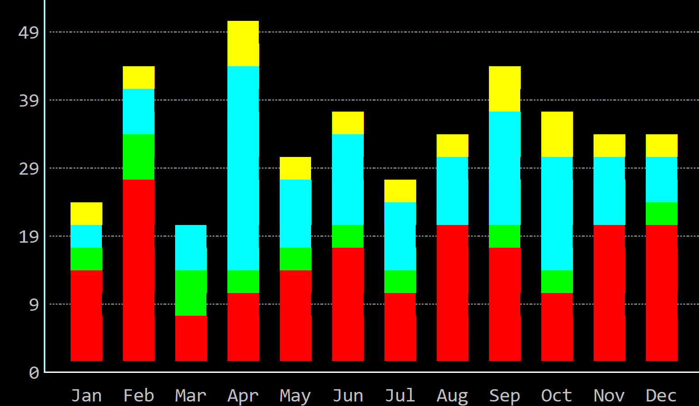

# VStackedBarChart

A `VStackedBarChart` draws one vertical column for each stack in a numeric series. A stack is a column of segments. Positive segments pile upward from zero, and negative segments pile downward, in the order they were added. The value type `T` is any numeric type that implements `Number`: `i8`, `i16`, `i32`, `i64`, `i128`, `u8`, `u16`, `u32`, `u64`, `u128`, `usize`, `isize`, `f32`, or `f64`.

The chart maps the stack totals onto the plot height, and can show a Y axis with a grid, labels under the stacks, and a horizontal scroll bar when the columns are wider than the control. Each stack can keep the chart defaults or override its thickness and spacing. Each segment can override its color and draw mode.



Create one with `VStackedBarChart::new` (a layout and initialization flags) or with the `vstackedbarchart!` macro. With `VStackedBarChart::new`, name the numeric type on the variable or with a turbofish:

```rs
let chart: VStackedBarChart<i32> = VStackedBarChart::new(layout!("d:f"), vstackedbarchart::Flags::ScrollBars);
let chart = VStackedBarChart::<f64>::new(layout!("d:f"), vstackedbarchart::Flags::None);
```

The macro takes the numeric type as its first parameter:

```rs
let c1 = vstackedbarchart!("i32,d:f");
let c2 = vstackedbarchart!("class:i32,x:1,y:1,w:60,h:20,flags:[ScrollBars,ShowZeroLineOnYAxis]");
let c3 = vstackedbarchart!("f64,d:f,scale:Percentage,xlabels:StackLabels,bar-width:3,stacks:[[1.5,2.0],[0.5,3.25]]");
```

A new chart starts empty. It scales stacks with `StackBarScale::FromZero`, shows the Y axis and its grid (6 characters wide, a label every 3 rows), and draws no X axis. Segments use the theme bar colors, cycling by segment index, so the first segment of every stack shares a color. The default thickness is 1, the default spacing is 1, and the default draw mode is a solid fill. Integer values are formatted with thousands separators. Floating-point values are formatted with two decimals. Percentage labels use a `%` suffix.

A VStackedBarChart supports all common parameters (as they are described in [Instantiate via Macros](../instantiate_via_macros.md) section). Besides them, the following **named parameters** are also accepted:

| Parameter name                                                                       | Type           | Positional parameter | Purpose                                                            |
| ------------------------------------------------------------------------------------ | -------------- | -------------------- | ------------------------------------------------------------------ |
| `class` or `type`                                                                    | String         | **Yes** (first)      | Numeric type of the series (`i32`, `f64`, ...)                     |
| `flags`                                                                              | Flags          | **No**               | Initialization flags                                               |
| `stacks` or `values` or `data`                                                       | List           | **No**               | Stacks to add. Each item is a list of segments or a stack description |
| `scale` or `stacksscale` or `stacks-scale` or `ss`                                   | String         | **No**               | How stack totals map onto the plot height                          |
| `xlabels` or `x-labels` or `xl` or `xaxis` or `x-axis`                               | String or List | **No**               | Labels drawn under the stacks                                      |
| `bar-width` or `barwidth` or `bw` or `default-bar-width` or `dbw`                    | Integer        | **No**               | Default stack thickness, from 1 to 100                             |
| `spacing` or `space` or `s` or `bar-spacing` or `default-bar-spacing` or `dbs`       | Integer        | **No**               | Default gap before a stack, from 0 to 100                          |
| `draw-mode` or `dm` or `bar-draw-mode` or `default-bar-draw-mode` or `dbdm`          | String         | **No**               | Default way to paint a segment                                     |
| `bar-color` or `barcolor` or `bar-attr` or `barattr` or `default-bar-attr`           | Dict           | **No**               | Default character attribute for segments                           |
| `numeric-format` or `nf`                                                             | Dict           | **No**               | Format used for values, Y-axis labels, and hover tooltips          |
| `percentage-format` or `pf`                                                          | Dict           | **No**               | Format used for percentage labels and the share in a tooltip       |
| `yaxis-width` or `y-axis-width` or `yw`                                              | Integer        | **No**               | Characters reserved for Y-axis labels (1 to 32)                    |
| `yaxis-step` or `y-axis-step` or `ystep` or `step`                                   | Integer        | **No**               | Rows between horizontal grid lines (1 to 255)                      |
| `yaxis-visible` or `y-axis-visible` or `yaxis`                                       | Bool           | **No**               | Shows or hides the Y axis                                          |
| `yaxis-grid` or `y-axis-grid` or `grid`                                              | Bool           | **No**               | Shows or hides the horizontal grid and its labels                  |
| `lsm` or `left-scroll-margin`                                                        | Integer        | **No**               | Left margin of the horizontal scroll bar                           |

## Flags

* `vstackedbarchart::Flags::ScrollBars` or `ScrollBars` (for macro initialization) — shows a horizontal scroll bar when the stacks are wider than the control. The bottom margin grows while the chart has focus so the scroll bar stays visible.
* `vstackedbarchart::Flags::DimBarsOnSelection` or `DimBarsOnSelection` (for macro initialization) — after a stack or a segment is selected, the rest of the chart is drawn with the inactive chart color. The selection is outlined with the theme selection border.
* `vstackedbarchart::Flags::ShowZeroLineOnYAxis` or `ShowZeroLineOnYAxis` (for macro initialization) — draws a solid horizontal line at value zero while the Y-axis grid is visible.

```rs
let chart = vstackedbarchart!("i32,d:f,flags:[ScrollBars,DimBarsOnSelection,ShowZeroLineOnYAxis]");
```

## Scale

`scale` chooses how stack totals become heights. The same values are available from `set_stacks_scale` as `vstackedbarchart::StackBarScale<T>`.

The upward total of a stack is the sum of its positive segments. The downward total is the sum of its negative segments. A value of zero, or a non-finite value, occupies no cells and is left out of both totals.

* `FromZero` or `zero` — every stack is drawn from zero. The visible range includes zero and every upward and downward total. This is the default.
* `FromZeroMinRange(min, max)` or `zero-min-range(min, max)` — same as `FromZero`, and the range is also expanded so that it covers `min` and `max`. A non-finite bound is treated as zero.
* `FitData` or `fit` — the smallest and largest upward and downward totals stretch across the full plot height. When those totals have no span, segments are not drawn.
* `Fixed(min, max)` or `fix(min, max)` — uses a fixed range. Totals outside it are drawn at the corresponding edge of the plot. When `min` is not lower than `max`, or either bound is non-finite, segments are not drawn.
* `Percentage` or `percent` — each stack is scaled so the absolute values of its segments sum to 100%. The plot runs from the largest downward share to the largest upward share. A stack of only positive values fills from 0% to 100%. A stack with both signs splits that 100% above and below zero.

```rs
let fit = vstackedbarchart!("f64,d:f,scale:Fit");
let fixed = vstackedbarchart!("i32,d:f,scale:Fixed(0,100)");
let padded = vstackedbarchart!("i32,d:f,scale:FromZeroMinRange(-20,80)");
let share = vstackedbarchart!("i32,d:f,scale:Percentage");
```

## X-axis labels

`xlabels` chooses the labels under the stacks. The same modes are available from `set_xaxis_label_mode` as `vstackedbarchart::XAxisLabelMode`.

* `None` — draws no X axis. This is the default.
* `Index(start)` — labels each stack with `start + stack index`. `Index(1)` labels the first stack `1`, the next `2`, and so on.
* `StackLabels` (also `labels`) — uses each stack's own label. Stacks with an empty label are skipped.
* A list of spans — each span covers a run of stacks. A span is `{start, count, label}`. `start` is the zero-based index of the first stack, and `count` is how many stacks the label covers (a count below 1 is treated as 1). Named fields are `start`, `count` (also accepted as `end`), and `label` (also `text` or `caption`). The second value is always a count of stacks.

Spans are copied into the chart, ordered by start index and then by end index. A span that overlaps an earlier one is dropped. A span label is stored in a 22-character buffer.

```rs
let by_index = vstackedbarchart!("i32,d:f,xlabels:Index(2020)");
let by_name = vstackedbarchart!("i32,d:f,xlabels:StackLabels,stacks:[{label:Q1,bars:[10,4]},{label:Q2,bars:[12,6]}]");
let by_span = vstackedbarchart!("i32,d:f,xlabels:[{0,2,'H1'},{2,2,'H2'}]");
```

The same spans from code:

```rs
let spans = [BarSpan::new(0, 2, "H1"), BarSpan::new(2, 2, "H2")];
chart.set_xaxis_label_mode(vstackedbarchart::XAxisLabelMode::Custom(&spans));
```

`BarSpan::new(0, 2, "H1")` labels stacks 0 and 1.

## Stacks

A stack stores its segments and an optional label. Thickness and spacing are also optional: a field left unset uses the chart default. Every segment in the stack uses that thickness. A value below 1 is raised to 1 when the stack is laid out, and a draw mode may raise it further. A sequence of numbers converts into a stack, so `chart.add_stack([10, 4, -2])` is enough for a default column.

Build a stack that overrides the defaults with `BarsStackBuilder`:

```rs
let stack = BarsStackBuilder::new()
    .label("Q1")
    .thickness(4)
    .spacing(2)
    .bar(12)
    .bar(StackBarBuilder::new(-3).label("Returns").build())
    .build();
chart.add_stack(stack);
```

In the `stacks` (or `values` or `data`) list, an item is either a list of segments or a dictionary. A dictionary may set the stack label, thickness, spacing, and the segments.

| Parameter name                 | Type    | Positional parameter | Purpose                                      |
| ------------------------------ | ------- | -------------------- | -------------------------------------------- |
| `label` or `text` or `caption` | String  | **Yes** (first)      | Label used by `StackLabels` and by the tooltip |
| `bars` or `values` or `data`   | List    | **No**               | Segments in this stack                       |
| `width` or `w` or `thickness`  | Integer | **No**               | Thickness in cells, from 0 to 255            |
| `space` or `spacing` or `s`    | Integer | **No**               | Gap, in cells, before this stack             |

```rs
let chart = vstackedbarchart!(
    "i32,d:f,stacks:[
        [10, 4, -2],
        {Q1, bars: [12, {3, label: Bonus}], width: 4, space: 1}
    ]"
);
```

### Segments

A segment stores a numeric value and an optional label. Color and draw mode are optional: a field left unset uses the chart default. A value of type `T` converts into a segment. Until a default color is set, segments cycle through the theme bar colors by their index inside the stack.

Build a segment with `StackBarBuilder`:

```rs
let bar = StackBarBuilder::new(42)
    .label("North")
    .attr(CharAttribute::with_fore_color(Color::Yellow))
    .draw_mode(StackBarDrawMode::Fill(BarFillType::Shade50))
    .build();
```

In a segment list, a dictionary describes the same fields. `value` is required. The other fields are optional.

| Parameter name                              | Type   | Positional parameter | Purpose                                      |
| ------------------------------------------- | ------ | -------------------- | -------------------------------------------- |
| `value` or `val` or `v`                     | Number | **Yes** (first)      | The segment value                            |
| `label` or `text` or `caption`              | String | **No**               | Label included in the hover tooltip         |
| `attr` or `attribute` or `charattr`         | Dict   | **No**               | Character attribute for this segment         |
| `draw-mode` or `drawmode` or `dm` or `mode` | String | **No**               | Draw mode for this segment                   |

```rs
let chart = vstackedbarchart!("i32,d:f,stacks:[[10,{25,label:North,attr:yellow},{40,dm:Fill(Shade50)}]]");
```

The label is included in the hover tooltip when it is not empty. It is not drawn on the X axis; the X axis uses the stack label or a span.

### Draw mode

`StackBarDrawMode` selects the glyph used to paint a segment. The default is `Fill(Solid)`. A stack is as wide as the thickest requirement among its segments. A requested thickness below that minimum is raised when the stack is laid out.

| Mode                    | Macro form                                 | Thickness  |
| ----------------------- | ------------------------------------------ | ---------- |
| `Fill(fill)`            | `Fill`, `Fill(Solid)`, `Fill(Shade50)`, `Fill('#')` | at least 1 |
| `Rectangle(line)`       | `Rectangle` or `Rect`, `Rectangle(Double)` | at least 2 |
| `FilledRectangle(line)` | `FilledRectangle` or `FilledRect`          | at least 3 |

A mode written without parentheses uses its default inner value: `Fill` is solid, and `Rectangle` / `FilledRectangle` use a single line.

`Fill` accepts the same characters as a [VBarChart](vbarchart.md#draw-mode) fill: `Solid` (█), `Shade75` (▓), `Shade50` (▒), `Shade25` (░), `Braille`, `Checkerboard`, `Grid`, `GridDouble`, `CrossHatch`, `Dashed`, `DiagonalUp`, `DiagonalDown`, `Notched`, or a custom glyph. In the macro, a custom glyph is a character (`Fill('#')`) or a code (`Fill(code: 0x2591)`).

`Rectangle` and `FilledRectangle` take a `LineType`: `Single`, `Double`, `SingleThick` (`thick`), `Border`, `Ascii`, `AsciiRound`, `SingleRound` (`round`), or `Braille`. `FilledRectangle` draws that outline around a solid block.

```rs
chart.set_default_bar_drawmode(StackBarDrawMode::Rectangle(LineType::Double));
chart.update_stack(0, |stack| {
    stack.get_mut(0).unwrap().set_draw_mode(StackBarDrawMode::Fill(BarFillType::Shade50));
});
```

### Number format

`numeric-format` (or `set_number_format`) controls the text used for Y-axis labels, the zero-line label, and the numbers in a hover tooltip. While the scale is `Percentage`, Y-axis labels use the percentage format instead. Tooltips still use this format for the stack total and the segment value.

The first value is the base: `dec` / `10`, `hex` / `16`, `oct` / `8`, or `bin` / `2`. Optional fields include `decimals` (or `precision`, at most 8), `group` (`0`, `3`, or `4`) with `sep`, `prefix`, `suffix`, and `digits`.

```rs
let chart = vstackedbarchart!("f64,d:f,numeric-format:{dec,decimals:1}");
let hex = vstackedbarchart!("i32,d:f,nf:{hex,prefix:0x}");
```

### Percentage format

`percentage-format` (or `set_percentage_format`) uses the same dictionary. A new chart uses a `%` suffix. This format is used for Y-axis labels while the scale is `Percentage`, and for the share appended to a tooltip value, such as `Value: 25 (25%)`.

```rs
let chart = vstackedbarchart!("i32,d:f,scale:Percentage,percentage-format:{dec,decimals:1,suffix:'%'}");
```

## Events

To intercept events from a VStackedBarChart, implement `VStackedBarChartEvents<T>` on the window that runs the event loop. The attribute `events = VStackedBarChartEvents<T>` generates the trait. All three methods are required.

```rs
pub trait VStackedBarChartEvents<T> {
    fn on_clear_selection(&mut self, handle: Handle<VStackedBarChart<T>>) -> EventProcessStatus;
    fn on_stack_selected(&mut self, handle: Handle<VStackedBarChart<T>>, index: u32) -> EventProcessStatus;
    fn on_cell_selected(&mut self, handle: Handle<VStackedBarChart<T>>, stack_index: u32, cell_index: u32) -> EventProcessStatus;
}
```

`on_cell_selected` runs when a click, or Up and Down, selects a segment that was not already selected. `stack_index` is the column and `cell_index` is the segment inside that column. `on_stack_selected` runs when a double-click, or Left and Right, selects a whole column. `index` is the stack index. `on_clear_selection` runs when a click lands outside every segment and something was selected. Repeating the current selection does not raise the event again. `select_stack`, `select_cell`, and `clear_selection` update the selection without raising an event.

## Methods

Besides the [Common methods for all Controls](../common_methods.md), a VStackedBarChart also has the following additional methods:

| Method                          | Purpose                                                                                                                                |
| ------------------------------- | -------------------------------------------------------------------------------------------------------------------------------------- |
| `add_stack(...)`                | Appends one stack and repaints. The argument is a `BarsStack` or any type that converts into one, such as `[10, 4, -2]`                |
| `add_stacks(...)`               | Appends several stacks and repaints once                                                                                               |
| `stacks_count()`                | Returns the number of stacks                                                                                                           |
| `get_stack(index)`              | Returns `Some(&BarsStack<T>)`, or `None` if `index` is out of range                                                                    |
| `update_stack(index, f)`        | Mutates one stack, then relayouts and repaints. Does nothing if `index` is out of range                                                |
| `clear()`                       | Removes every stack, clears the selection, and repaints                                                                                |
| `ensure_visible(index)`         | Scrolls horizontally so the stack at `index` is visible. Does nothing if `index` is out of range or the stack is already fully visible |
| `selected_stack()`              | Returns the index of the selected stack, whether the whole column or one segment is selected, or `None`                                |
| `selected_cell()`               | Returns the index of the selected segment inside its stack, or `None` when the whole stack is selected or nothing is selected          |
| `select_stack(index)`           | Selects the whole stack without raising an event. Does nothing if `index` is out of range                                              |
| `select_cell(stack, cell)`      | Selects one segment without raising an event. Does nothing if either index is out of range                                             |
| `clear_selection()`             | Clears the selection without raising an event                                                                                          |
| `set_stacks_scale(...)`         | Sets the `StackBarScale` used to map totals onto the plot height                                                                       |
| `set_number_format(...)`        | Sets the `FormatNumber` used for values, axis labels, and tooltips                                                                     |
| `set_percentage_format(...)`    | Sets the `FormatNumber` used for percentage labels and the share in a tooltip                                                          |
| `set_default_bar_width(...)`    | Sets the thickness, in cells, of stacks that do not specify their own. Values below 1 are treated as 1                                 |
| `set_default_bar_spacing(...)`  | Sets the gap, in cells, before stacks that do not specify their own                                                                    |
| `set_default_bar_drawmode(...)` | Sets the draw mode of segments that do not specify their own. The mode can raise a stack's thickness                                   |
| `set_default_bar_attr(...)`     | Sets the character attribute of segments that do not specify their own. After this call, segments no longer cycle through the theme colors |
| `set_yaxis_visible(...)`        | Shows or hides the Y axis and the column reserved for its labels                                                                       |
| `set_yaxis_show_grid(...)`      | Shows or hides the horizontal grid lines and the numeric labels beside them                                                            |
| `set_yaxis_width(...)`          | Sets how many characters are reserved for Y-axis labels. Values below 1 are treated as 1. Used only while the Y axis is visible        |
| `set_yaxis_step(...)`           | Sets the distance, in rows, between horizontal grid lines. Values below 1 are treated as 1                                             |
| `set_xaxis_label_mode(...)`     | Sets how labels are drawn under the stacks                                                                                             |

### `BarsStack`

On a stack returned by `get_stack` or passed into `update_stack`:

| Method                                               | Purpose                                                    |
| ---------------------------------------------------- | ---------------------------------------------------------- |
| `add_bar(...)` / `add_bars(...)`                     | Append one segment, or several. A number converts into a segment |
| `count()`                                            | Number of segments                                         |
| `get(index)` / `get_mut(index)`                      | Borrow one segment, or `None` if out of range              |
| `label()` / `set_label(...)`                         | Read or replace the stack label                            |
| `thickness()` / `set_thickness(...)` / `clear_thickness()` | Stack thickness, or the chart default when cleared   |
| `spacing()` / `set_spacing(...)` / `clear_spacing()` | Gap before the stack, or the chart default when cleared   |

Setters return `&mut Self`, so they can be chained.

```rs
chart.update_stack(0, |stack| {
    stack.set_label("Q1");
    stack.get_mut(1).unwrap().set_value(20);
});
```

### `StackBar`

On a segment returned by `BarsStack::get`:

| Method                                             | Purpose                                      |
| -------------------------------------------------- | -------------------------------------------- |
| `value()` / `set_value(...)`                       | Read or replace the numeric value            |
| `label()` / `set_label(...)`                       | Read or replace the label                    |
| `attr()` / `set_attr(...)` / `clear_attr()`        | Segment color, or the chart default when cleared |
| `draw_mode()` / `set_draw_mode(...)` / `clear_draw_mode()` | Draw mode, or the chart default when cleared |

## Key association

The following keys are processed by a VStackedBarChart when it has focus.

| Key                        | Purpose                                                                                          |
| -------------------------- | ------------------------------------------------------------------------------------------------ |
| `Left` / `Right`           | Select the previous or next stack and raise `on_stack_selected` when the selection changes      |
| `Up` / `Down`              | Move between segments of the current stack and raise `on_cell_selected` when the selection changes |
| `Home`                     | Scroll to the start of the series                                                                |
| `End`                       | Scroll to the end of the series                                                                  |
| `Ctrl+Left` / `Ctrl+Right` | Scroll by one stack, without changing the selection                                              |

With nothing selected, `Left` or `Right` selects the first stack. `Up` or `Down` selects a segment of the current stack, or of the first stack when nothing is selected. Segments that occupy no cells are skipped.

## Mouse association

| Action                         | Purpose                                                                                                                                                          |
| ------------------------------ | ---------------------------------------------------------------------------------------------------------------------------------------------------------------- |
| Hover                          | Shows a tooltip over the segment under the cursor. The tooltip lists the stack label (when set), the net stack total, the segment label (when set), and the value. In percentage scale the value also includes its share of the stack |
| Click on a segment             | Selects that segment and raises `on_cell_selected` when the selection changes. The click has to land on the painted segment                                      |
| Click outside a segment        | Clears the selection and raises `on_clear_selection` when something was selected                                                                                 |
| Double-click on a stack        | Selects the whole column and raises `on_stack_selected` when the selection changes                                                                               |
| Double-click outside a stack   | Leaves the selection unchanged                                                                                                                                   |
| Wheel left or wheel up         | Scrolls one cell toward the start of the series                                                                                                                  |
| Wheel right or wheel down      | Scrolls one cell toward the end of the series                                                                                                                    |
| Drag the scroll bar            | Scrolls the series when `ScrollBars` is enabled                                                                                                                  |

## Example

The following window shows two quarters. Clicking a segment writes the quarter, the segment label, and its value into the window title. Double-clicking a column, or moving with Left and Right, writes the quarter. Clearing the selection restores the original title.

A short sample is in `examples/vstackedbarchart`. A larger editor (per-segment appearance, axes, and scale) is in `examples/vstackbarchart_editor`.

```rs
use appcui::prelude::*;

#[Window(events = VStackedBarChartEvents<i32>)]
struct MyWin {
    chart: Handle<VStackedBarChart<i32>>,
}

impl MyWin {
    fn new() -> Self {
        let mut win = MyWin {
            base: window!("Sales,d:f"),
            chart: Handle::None,
        };
        let mut chart = vstackedbarchart!(
            "i32,d:f,
             flags:[ScrollBars,ShowZeroLineOnYAxis],
             xlabels:StackLabels,
             bar-width:3,
             spacing:1,
             draw-mode:Fill(Shade50)"
        );
        chart.add_stack(
            BarsStackBuilder::new()
                .label("Q1")
                .bar(StackBarBuilder::new(12).label("North").build())
                .bar(StackBarBuilder::new(8).label("South").build())
                .bar(StackBarBuilder::new(-3).label("Returns").build())
                .build(),
        );
        chart.add_stack(
            BarsStackBuilder::new()
                .label("Q2")
                .bar(StackBarBuilder::new(15).label("North").build())
                .bar(StackBarBuilder::new(6).label("South").build())
                .bar(StackBarBuilder::new(-2).label("Returns").build())
                .build(),
        );
        win.chart = win.add(chart);
        win
    }
}

impl VStackedBarChartEvents<i32> for MyWin {
    fn on_cell_selected(&mut self, handle: Handle<VStackedBarChart<i32>>, stack_index: u32, cell_index: u32) -> EventProcessStatus {
        if let Some(chart) = self.control(handle) {
            if let Some(stack) = chart.get_stack(stack_index as usize) {
                if let Some(bar) = stack.get(cell_index as usize) {
                    let title = format!("{} - {} = {}", stack.label(), bar.label(), bar.value());
                    self.set_title(&title);
                }
            }
        }
        EventProcessStatus::Processed
    }

    fn on_stack_selected(&mut self, handle: Handle<VStackedBarChart<i32>>, index: u32) -> EventProcessStatus {
        if let Some(chart) = self.control(handle) {
            if let Some(stack) = chart.get_stack(index as usize) {
                let title = format!("Sales - {}", stack.label());
                self.set_title(&title);
            }
        }
        EventProcessStatus::Processed
    }

    fn on_clear_selection(&mut self, _: Handle<VStackedBarChart<i32>>) -> EventProcessStatus {
        self.set_title("Sales");
        EventProcessStatus::Processed
    }
}

fn main() -> Result<(), appcui::system::Error> {
    App::new().window(MyWin::new).run()
}
```
